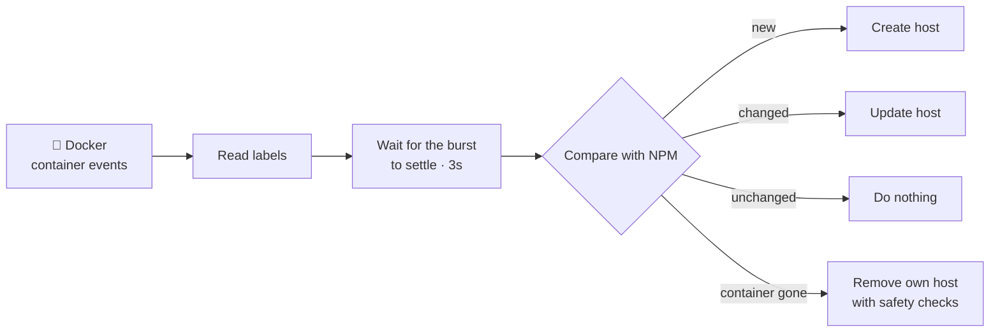

<div align="center">

# 🏷️ npmplus-docker-sync

### Add one label to a container. Get a working HTTPS proxy host in Nginx Proxy Manager.

**No clicking. No copy-paste. No forgotten hosts.**

[](https://github.com/VentumPhoenix/npmplus-docker-sync/actions/workflows/ci.yml)
[](https://github.com/VentumPhoenix/npmplus-docker-sync/actions/workflows/codeql.yml)
[](https://goreportcard.com/report/github.com/VentumPhoenix/npmplus-docker-sync)
[](LICENSE)
[](https://github.com/VentumPhoenix/npmplus-docker-sync/pkgs/container/npmplus-docker-sync)

Works with **[Nginx Proxy Manager](https://github.com/NginxProxyManager/nginx-proxy-manager)** and **[NPMplus](https://github.com/ZoeyVid/NPMplus)** · ~8 MB image · read-only Docker access

[Quick start](#-quick-start) · [Examples](#-examples) · [Is it safe?](#%EF%B8%8F-is-it-safe) · [Configuration](#%EF%B8%8F-configuration) · [Troubleshooting](#-troubleshooting) · [Docs](#-documentation)

</div>

---

## 🤔 What does it do?

You run apps in Docker and use Nginx Proxy Manager (NPM) to make them reachable
under nice domains with HTTPS. Normally, every new app means opening the NPM
UI, clicking through a form, picking a certificate — and remembering to delete
the host when the app is gone.

**npmplus-docker-sync does that for you.** You describe the domain right next
to the app, and NPM follows automatically.

```yaml
services:
  whoami:
    image: traefik/whoami
    networks: [npm]
    labels:
      npm.proxy.domains: "whoami.example.com"   # ← that's it
```

A few seconds after `docker compose up`, NPM has a proxy host
`whoami.example.com` — pointing at the right container and port, with the
matching certificate attached and HTTPS enforced.

<table>
<tr><th>😩 Without</th><th>😎 With npmplus-docker-sync</th></tr>
<tr><td>

1. Start the container
2. Open the NPM UI
3. *Add proxy host*, type domain
4. Look up the container IP and port
5. Pick the certificate, tick *Force SSL*
6. Save — and repeat for every app
7. Forget to delete it later

</td><td>

1. Add one label
2. `docker compose up -d`
3. ✅ Done

Stop the app → the host is disabled.
Remove the app → the host is cleaned up.

</td></tr>
</table>

If you know Traefik's labels: it's that workflow, but for Nginx Proxy Manager —
you keep NPM and its UI exactly as they are.

## ✨ Highlights

- 🏷️ **One label is enough** — port, certificate and HTTPS are figured out automatically
- 🧩 **All four NPM types** — proxy hosts, redirections, TCP/UDP streams and 404 hosts
- 🔐 **Certificates pick themselves** — the best matching one, exact before wildcard
- 🎯 **No more `502 Bad Gateway`** — uses the container's IP on the network NPM can actually reach
- 🛡️ **Hard to break** — never touches hosts you made by hand, and refuses suspicious mass deletions
- ⚡ **Fast and quiet** — reacts in seconds, and 20 containers starting at once cause *one* update
- 🤝 **Drop-in for [Redth/npm-docker-sync](https://github.com/Redth/npm-docker-sync)** — its labels work unchanged
- 🔒 **Secure by default** — talks to Docker through a read-only socket proxy, runs as non-root in a ~8 MB `scratch` image
- 📊 **Observable** — health checks, a JSON status page and Prometheus metrics built in

## 🚀 Quick start

**You need:** Docker with Compose. Ready-made stacks for NPM and NPMplus live in
[deploy/](deploy/README.md) — from a two-container try-out to a hardened setup
with CrowdSec:

|  | NPM | NPMplus |
|---|---|---|
| **1 · Simple** — try it out | [npm/1-simple](deploy/npm/1-simple/compose.yaml) | [npmplus/1-simple](deploy/npmplus/1-simple/compose.yaml) |
| **2 · Standard** — recommended | [npm/2-standard](deploy/npm/2-standard/compose.yaml) | [npmplus/2-standard](deploy/npmplus/2-standard/compose.yaml) |
| **3 · Hardened** — exposed servers | [npm/3-hardened](deploy/npm/3-hardened/compose.yaml) | [npmplus/3-hardened](deploy/npmplus/3-hardened/compose.yaml) |
| **Already running NPM?** | [existing-npm](deploy/existing-npm/compose.yaml) | same file |

**1. Pick a stack**

```bash
git clone https://github.com/VentumPhoenix/npmplus-docker-sync.git
cd npmplus-docker-sync/deploy/npmplus/2-standard
```

**2. Fill in `.env`**

```bash
cp .env.example .env    # domain of the admin UI, e-mail, password
```

**3. Start it**

```bash
docker compose up -d
docker compose logs -f npmplus-docker-sync
```

**4. Label your apps** — as in the example above, or start
[deploy/example-app](deploy/example-app/compose.yaml). Done! 🎉

> [!TIP]
> Adding it to an NPM that already has hosts? `existing-npm` starts with
> `DRY_RUN=true`: the tool only **logs** what it would change. Check the log,
> then set it to `false`.

<details>
<summary><b>Without Compose (<code>docker run</code>)</b></summary>

```bash
docker run -d --name npmplus-docker-sync \
  --network npm \
  -e DOCKER_HOST=tcp://docker-socket-proxy:2375 \
  -e NPM_URL=http://npm:81 \
  -e NPM_IDENTITY=admin@example.com \
  -e NPM_SECRET=changeme \
  -e NPM_NETWORK=npm \
  ghcr.io/ventumphoenix/npmplus-docker-sync:latest
```

For a quick test without a socket proxy, see
[deploy/npm/1-simple](deploy/npm/1-simple/compose.yaml).
</details>

<details>
<summary><b>Build from source</b></summary>

Requires Go 1.26 or newer.

```bash
make build     # static binary ./npmplus-docker-sync
make test      # race-enabled unit tests
make check     # fmt + vet + lint + test
```
</details>

## 📖 Examples

Copy what you need into the `labels:` of your container.

**A web app with HTTPS**

```yaml
npm.proxy.domains: "app.example.com"
```

**…on a specific port, with several domains**

```yaml
npm.proxy.domains: "app.example.com, www.app.example.com"
npm.proxy.port: "8080"
```

**…behind a login (Authelia, Authentik, …) and an access list** *(login: NPMplus only)*

```yaml
npm.proxy.domains: "kuma.example.com"
npm.proxy.auth_request: "authelia"
npm.proxy.access_list: "Intern"
```

**Redirect an old domain**

```yaml
npm.redirect.domains: "old-app.example.com"
npm.redirect.forward_domain: "app.example.com"
```

**Expose a database as a TCP stream**

```yaml
npm.stream.incoming_port: "5432"
```

**Show a 404 page for a parked domain**

```yaml
npm.404.domains: "parked.example.com"
```

**Several things from one container** — just number them:

```yaml
npm.proxy.domains: "app.example.com"          # 0: the web UI
npm.1.proxy.domains: "metrics.example.com"    # 1: a second port
npm.1.proxy.port: "9090"
npm.2.stream.incoming_port: "5432"            # 2: the database
```

**Leave a container alone**

```yaml
npm.enable: "false"
```

📚 **Every label** — with what it does, its default and aliases — is listed in
[docs/FIELDS.md](docs/FIELDS.md). The rules behind them are in
[docs/LABELS.md](docs/LABELS.md).

<details>
<summary><b>Label syntax in detail</b></summary>

```
npm.<kind>.<field>              one resource
npm.<index>.<kind>.<field>      several resources (npm.<kind>.<index>.<field> works too)
npm.<field>                     shorthand for npm.proxy.<field>
npm.enable=false                ignore this container
```

- `<kind>` is `proxy`, `redirect`, `stream` or `404`.
- `domains` is the domain people visit; `host` is the upstream the app is
  served from (for redirections and 404 hosts, `host` means `domains`).
- `.`, `_` and `-` are interchangeable in field names: `ssl.hsts.subdomains`
  = `ssl_hsts_subdomains`.
- Booleans accept `true/false`, `1/0`, `yes/no`, `on/off`.
- The prefix `npm` can be changed with `LABEL_PREFIX`.
- A typo gets a warning with a suggestion (`did you mean npm.proxy.ssl.forced?`).
</details>

<details>
<summary><b>Automatic certificates</b></summary>

By default (`certificate: auto`) the tool picks the certificate in NPM that fits
best: exact match before wildcard, then the one valid the longest. Expired
certificates are ignored, and a certificate that already fits is never swapped
for an equally good one. New certificates from the NPM UI are noticed within a
minute.

```yaml
npm.proxy.certificate: "auto"                # the default
npm.proxy.certificate: "12"                  # a fixed id
npm.proxy.certificate: "*.home.example.com"  # whatever covers this domain
npm.proxy.certificate: "name:My wildcard"    # by name
npm.proxy.certificate: "new"                 # request a Let's Encrypt one
npm.proxy.certificate: "none"                # plain HTTP
```

HTTPS is forced automatically as soon as a certificate is attached.
</details>

<details>
<summary><b>Automatic ports</b></summary>

If a container exposes exactly one port, you don't need a port label. With
several ports, `NPM_PORT_PREFERENCE` (`80,8080,3000,8000,443`) decides. If none
of them fits, the host is skipped and the log names the ports it found.
</details>

<details>
<summary><b>Defaults for all containers</b></summary>

Every label has a matching environment variable on the sync container. A label
on a container always wins:

```yaml
# on npmplus-docker-sync: HTTPS everywhere ...
NPM_PROXY_SSL_FORCE: "true"
```

```yaml
# ... except on this container
npm.proxy.ssl.force: "false"
```

Order: indexed label → label → `NPM_<KIND>_<FIELD>` → `NPM_DEFAULT_<FIELD>` →
built-in default.
</details>

<details>
<summary><b>NPMplus extras (groups, CrowdSec, HTTP/3, …)</b></summary>

Everything NPMplus can do is a label: `auth_request`, `crowdsec_appsec`,
`noindex`, `x_frame_options`, `fancyindex`, `upstream_compression`,
`request_buffering`, `response_buffering`, `location_config`, HTTP/3, custom
locations — and `group`, which sorts hosts into the folders of the NPMplus UI:

```yaml
npm.proxy.group: "Production"
```

Against the original Nginx Proxy Manager, NPMplus-only settings are simply
left out and reported once — nothing fails.
</details>

<details>
<summary><b>Check labels before deploying</b></summary>

```bash
npmplus-docker-sync validate              # check the labels of running containers
docker compose config --format json > stack.json
npmplus-docker-sync validate stack.json   # check a stack before it starts
npmplus-docker-sync sync                  # one sync, then exit
```

`validate` never contacts NPM and exits non-zero on broken labels — handy as a
CI step.
</details>

## 🛡️ Is it safe?

Short answer: **it is built to never destroy something you care about.**

| Situation | What happens |
|---|---|
| You created a host **by hand** in NPM | Never deleted. Only hosts the tool created itself are ever removed. |
| Another tool (e.g. Redth's) created a host | Never touched. |
| A container is **stopped** | Its host is **disabled**, not deleted — a restart just turns it back on. |
| A container is restarted or updated | Nothing changes (1 minute grace period). |
| A label contains a **typo** | That container's hosts are protected, not deleted. |
| A run would delete **many hosts at once** | Refused. (`DELETE_GUARD`, default: more than half) |
| Docker reports **no containers at all** | Nothing is deleted. |
| The domain is already used by another host | Reported as a conflict, nothing is overwritten. |
| Several Docker hosts share **one NPM** | Each instance only manages its own hosts. |
| You **update NPM / NPMplus** | Your hosts stay yours — see the note below. |

**How it recognizes its own hosts:** each one gets a comment line at the top of
its *Advanced* config in NPM — `# npmplus-docker-sync: managed from Docker
labels, do not edit or remove this line | …`. nginx ignores it, this tool
relies on it: leave it there. A host without it counts as hand-made.

> [!IMPORTANT]
> **Update this tool before NPMplus.** The next NPMplus release clears the
> place where versions up to v1.0.0-beta.9 recorded their hosts; v1.0.0-beta.10
> adds the line above to every host on its first run.
> [Details](docs/MIGRATION.md#from-v100-beta9-to-v100-beta10)

> [!CAUTION]
> **Before your first real run:** if this tool ever created a host for
> something you still need — like the NPM admin UI itself — make sure that
> container still has its `npm.*` labels. Run once with `DRY_RUN=true` and
> check the log for `would delete` lines.

**Docker access is read-only.** The recommended setup goes through a
[docker-socket-proxy](https://github.com/Tecnativa/docker-socket-proxy) that
only allows *reading* containers and events, so even a compromised sync
container cannot start, stop or change anything. The container runs as
non-root from an empty `scratch` image with a read-only filesystem, and the NPM
password never appears in logs.

More: [every deletion rule](docs/DELETION.md) · [threat model](SECURITY.md)

## ⚙️ Configuration

Most setups only need these:

| Variable | Default | What it does |
|---|---|---|
| `NPM_URL` | — | **Required.** Address of the NPM API, e.g. `http://npm:81` |
| `NPM_IDENTITY` | — | **Required.** NPM admin e-mail |
| `NPM_SECRET` / `NPM_SECRET_FILE` | — | **Required.** NPM admin password (or a file containing it) |
| `NPM_NETWORK` | — | The Docker network NPM and your apps share |
| `DOCKER_HOST` | `unix:///var/run/docker.sock` | How to reach Docker (`tcp://docker-socket-proxy:2375` in the recommended setup) |
| `DRY_RUN` | `false` | Only log what would change |
| `NPM_ON_STOP` | `disable` | What a stopped container does to its hosts: `disable`, `keep` or `delete` |
| `LOG_LEVEL` | `info` | `debug`, `info`, `warn`, `error` |
| `HEALTH_ADDR` | — | Turn on `/healthz`, `/readyz`, `/status`, `/metrics`, e.g. `:8080` |

Any variable can be read from a file by adding `_FILE` (Docker secrets). All
variables, with aliases and tips: [docs/CONFIGURATION.md](docs/CONFIGURATION.md).

**NPM or NPMplus?** Both work, detected automatically. The tool reads which
fields the server accepts from the server itself, so a new NPM or NPMplus
release rarely needs an update here. NPMplus-only settings (HTTP/3, CrowdSec,
groups, forward auth, …) are simply left out against NPM and reported once.

> [!TIP]
> Pin your NPM/NPMplus image to a version tag rather than `:latest`.

## 🔍 How it works



1. **On startup** it compares all labelled containers with everything in NPM
   and fixes the differences — so downtime never leaves things out of sync.
2. **Then it listens** for containers starting and stopping, and syncs again
   within seconds.
3. **Every 5 minutes** it does a full check anyway, and every minute it looks
   for new certificates.
4. **Unchanged hosts cost nothing** — no API write happens unless something
   actually changed.

**Why the container IP?** NPM must reach your app, and container *names* only
work if NPM resolves Docker's internal DNS — the usual cause of
`502 Bad Gateway`. So the upstream is the container's IP in the network NPM
shares (`NPM_NETWORK`). [How it is chosen](docs/LABELS.md#upstream-host) ·
[Architecture](docs/ARCHITECTURE.md)

## 📊 Monitoring

With `HEALTH_ADDR=:8080`:

| Endpoint | Shows |
|---|---|
| `/healthz` | The process is alive |
| `/readyz` | Docker and NPM are reachable and a sync has run |
| `/status` | Every managed host as JSON, including errors and retries |
| `/metrics` | Prometheus metrics (runs, errors, changes, blocked deletions, …) |

The image has a built-in Docker `HEALTHCHECK`, so `docker ps` shows its health
and other services can use `depends_on: { condition: service_healthy }`.

## 🩺 Troubleshooting

<details>
<summary><b>Nothing happens when I start a labelled container</b></summary>

Run with `LOG_LEVEL=debug`. No `docker event` lines? Then events aren't arriving
— check `DOCKER_HOST` and that the socket proxy has `EVENTS=1`. Events arrive
but nothing is created? Then a label is probably wrong — the log names it, often
with a suggestion. The startup line `container overview managed=… opted_out=…`
shows how each container was classified.
</details>

<details>
<summary><b><code>login to http://npm:81 failed</code></b></summary>

`NPM_URL` must point to the **admin/API port** (81 by default — not 80 or 443).
Test your credentials:

```bash
curl -s -X POST http://npm:81/api/tokens \
  -H 'Content-Type: application/json' \
  -d '{"identity":"admin@example.com","secret":"changeme"}'
```
</details>

<details>
<summary><b><code>502 Bad Gateway</code>, or <code>container is not attached to &lt;network&gt;</code></b></summary>

NPM and your app must share a Docker network. Attach both to it and set
`NPM_NETWORK` to its name — or give the host an explicit `npm.proxy.host`.
</details>

<details>
<summary><b><code>400 data must NOT have additional properties</code></b></summary>

The server refused a field. The tool re-reads what the server accepts right
away, so the next sync usually succeeds. If it keeps failing, run with
`LOG_LEVEL=debug` (names the fields) and please open an issue with that output.
</details>

<details>
<summary><b>The wrong certificate was attached</b></summary>

The log says why (`"msg":"certificate selected", "match":"wildcard", …`). Pin
the one you want with `npm.proxy.certificate: "<id>"`, or use `"none"` for plain
HTTP.
</details>

<details>
<summary><b><code>refusing to delete: …</code> in the log</b></summary>

A safety check stopped a run that would have removed too many hosts. The
message says why (changed `LABEL_PREFIX`, no containers seen, or simply too
many at once). Fix the cause — or, if the deletion is really intended, run once
with `DELETE_GUARD=off`.
</details>

<details>
<summary><b><code>domain already used by another host</code></b></summary>

Another host in NPM (made by hand or by another tool) already serves that
domain. The message names its id — remove or rename it, and the next sync
creates yours.
</details>

<details>
<summary><b>A host disappeared after stopping a container</b></summary>

By default stopped containers only *disable* their host. Check whether
`NPM_ON_STOP=delete` is set, and see [docs/DELETION.md](docs/DELETION.md).
</details>

<details>
<summary><b>Streams or 404 hosts are not created</b></summary>

Check `SYNC_KINDS`. A warning *"collection is not available on this npm
instance"* means your NPM doesn't offer that type.
</details>

<details>
<summary><b><code>permission denied</code> on /var/run/docker.sock</b></summary>

Only with the *simple* stacks, which mount the socket directly: set
`DOCKER_GID=$(getent group docker | cut -d: -f3)` in `.env`. The socket-proxy
stacks avoid this entirely.
</details>

## 🔄 Coming from Redth/npm-docker-sync?

Your labels and environment variables work unchanged. Both tools can even run
against the same NPM without deleting each other's hosts. To take over the
hosts Redth's tool created, set `MIGRATE_FROM_REDTH=true` — see
[docs/MIGRATION.md](docs/MIGRATION.md).

## 📚 Documentation

| Document | What's in it |
|---|---|
| [Labels](docs/LABELS.md) | syntax, defaults, certificates, groups, locations, streams |
| [All label fields](docs/FIELDS.md) | every label with aliases, defaults and env variables (generated) |
| [Configuration](docs/CONFIGURATION.md) | every environment variable, health, metrics, commands |
| [Deletion](docs/DELETION.md) | when something is deleted — and what prevents it |
| [Upgrading](docs/MIGRATION.md) | per release, and coming from Redth/npm-docker-sync |
| [Compatibility](docs/COMPATIBILITY.md) | supported NPM/NPMplus versions, the 1.0 promise |
| [Architecture](docs/ARCHITECTURE.md) | how it works inside |
| [Security](SECURITY.md) | threat model, reporting a vulnerability |

## 🗺️ Roadmap

**1.0.0** — the label and marker format are final; what is left:

- [x] Ownership that survives NPMplus' meta-to-columns migration *(beta.10)*
- [x] Server capabilities read from `/api/schema` *(beta.10)*
- [x] Upgrade tests against real NPM and NPMplus containers *(beta.10)*
- [x] Fixes from testing against the next NPMplus release *(beta.11)*
- [ ] A few weeks of beta.11 in real use
- [ ] The NPMplus release with the new API in the test matrix

**After 1.0** — new features in 1.x releases, without breaking changes:

- Upstream modes: container name, or host IP with published ports
- Waiting for a container to be healthy before publishing it (`NPM_WAIT_HEALTHY`)
- Docker Swarm service labels
- NPMplus mTLS client certificates and certificate requests for streams

See the [changelog](CHANGELOG.md) for what changed, and
[COMPATIBILITY.md](docs/COMPATIBILITY.md#the-10-promise) for what stays stable.

## 🤝 Contributing

Bug reports, missing labels and pull requests are welcome — see
[CONTRIBUTING.md](CONTRIBUTING.md). If this tool saves you some clicks, a ⭐
helps others find it.

## 🙏 Acknowledgements

Built on [Nginx Proxy Manager](https://nginxproxymanager.com/) by jc21,
[NPMplus](https://github.com/ZoeyVid/NPMplus) by ZoeyVid and
[docker-socket-proxy](https://github.com/Tecnativa/docker-socket-proxy) by
Tecnativa. Inspired by Traefik's label-driven workflow and by
[Redth/npm-docker-sync](https://github.com/Redth/npm-docker-sync).
Not affiliated with or endorsed by any of these projects.

## 📄 License

[MIT](LICENSE)
